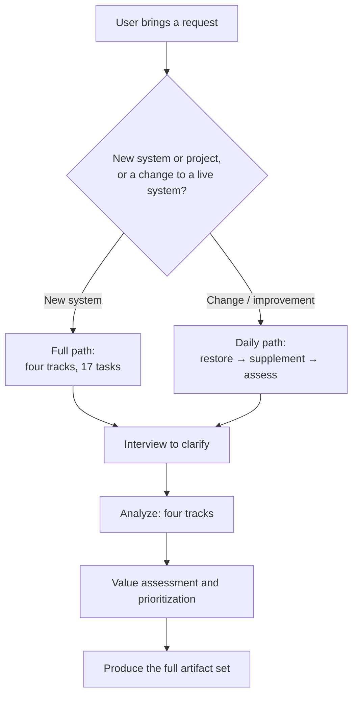

# Effective Requirements Analysis

A requirements-analysis method and toolkit for **B2B / enterprise systems** product managers. It turns one vague business request into a complete, traceable, reviewable, buildable set of requirements documents.

**Core principle: a requirement is expectation minus current state.** What users ask for is always a *solution-level* requirement ("add a page", "add a filter", "support export"). Requirements analysis routes around the solution to recover the *problem-level* requirement — who, in what business situation, is affected how, and what is lost — and only then does the analyst propose a solution that costs less.

**We are the solution experts; the customer is only the problem expert.**

The output is not one document. It is a full set: value / functional / data / non-functional requirement tracks, plus business rules and constraints.

---

## The Iron Rule: Interview First, Analyze Second

**Until the user has answered the first round of questions, produce exactly two files: a Clarification Question List and an Interview & Assumption Register. No other requirement artifact may be written.**

This is not ceremony. Without an interview, problem-level requirements can only be guessed. Every guess enters the document wearing the costume of a confirmed requirement, and becomes impossible to trace, impossible to rework, impossible to verify.

### Stage Gates

| Stage | May produce | Must not produce |
|---|---|---|
| **G0 — nothing asked yet** | Clarification Question List, Interview & Assumption Register | Any other file |
| **G1 — asked, no answers yet** | The same two files; may append new questions (`Q-xx`) | Problem cards, stakeholder profiles, processes, scenarios, models, feature lists, SRS — **including ones labeled "working draft" or "for discussion"** |
| **G2 — first-round answers received** | Complete the register with confirmed facts; working drafts allowed, but every line must be tagged `A-xx` or `S-xx` | Conclusions without a source tag |
| **G3 — clarification complete** | The full artifact set (see `references/artifacts.md`) | — |

**G2 → G3 does not wait for every question to be answered.** Once in G2 the full artifact set may be produced; content whose question is still unanswered **keeps its `S-xx` tag** all the way through acceptance criteria and test cases. Waiting for "everything answered" is unrealistic — it means never producing anything.

**Threshold to enter G2: the core questions must have been answered** — Who, Why, current state, frequency, plus the three mandatory questions; at least 5 of these answered. One tangential answer (say, "we need it by Q3") is not enough to open the gate.

**Partial answers do not excuse downstream tags.** After the gate opens, content tied to an unanswered `Q-xx` **stays tagged `S-xx`** — it does not silently become `A-xx` because the gate moved. When downstream functional requirements cite unconfirmed information, the tag must travel with them into acceptance criteria and test cases.

**An `S-xx` may only record what we believe, how we verify it, and what happens if it fails.** Writing `S-03` "approval might be a single-level flow" is fine (verifiable, consequential). Writing `S-03` "the approval flow should be designed as a single node with draft/pending/approved/rejected states" is not — that is a process-analysis conclusion, a G2/G3 artifact. The test: **is the answer to this `S-xx` a yes/no, or a whole structure?** Yes/no → it stays an `S-xx`. A whole structure → it is an analysis conclusion and must not appear in G1.

**"Working draft", "first cut", "assumption version", "for discussion" are not back doors around G1.** Problem cards, processes, scenarios, and models written at G1 get mixed with real deliverables: the user cannot tell what is confirmed from what is guessed, and reviewers cannot target their verification.

**The gate governs content, not file count.** Smuggling problem cards, flowcharts, domain models, or feature lists into an "appendix" or "table" inside the register still leaves two files on disk, but the content is already polluted — the gate fails anyway. At G1 the two files may contain only: the questions themselves, what the user has already answered, numbered assumptions with their verification plans, and term definitions. **No analysis conclusions** (no processes, no scenarios, no models, no features, no "the system shall include…").

**Renaming a heading does not evade the gate.** The script checks content shape, not wording. Calling a feature list "Appendix: what we're doing this time", or calling a process table "interview highlights", does not help: a header containing steps/owners/modules, an out-of-range identifier such as `FP-01` or `D-01`, an assertion like "the system shall include…", or a bare list of unnumbered feature items will all be caught. **The judgement is whether the content is an analysis conclusion — not which heading it hides under.**

**The G1 → G2 boundary is "the user answered a question", not "the user said something".** Information the user attaches to their request ("that's all three areas", "two weeks to launch") is recorded as `A-xx` (source: user's own words), but it **does not advance the gate** — until a `Q-xx` has been answered, there are no answers.

When the user pushes for a deliverable, the correct deliverable **is the Clarification Question List** — it is inherently reviewable, checkable, and batch-answerable. Eight well-aimed questions beat a hundred guessed requirements.

Interview records use fixed prefixes so later artifacts can trace back:

| Prefix | Meaning |
|---|---|
| `Q-xx` | Question asked, awaiting an answer |
| `A-xx` | Fact confirmed by the user |
| `S-xx` | Analyst's assumption — must also state how to verify it and what happens if it fails (both columns mandatory; blank means unwritten) |
| `T-xx` | Business term definition (ambiguous terms must be clarified) |

**Interviews happen in the conversation, not only in files.** Put the `Q-xx` questions in your reply and let the user answer them there — use the questioning tool if one is available, asking 2–4 of the most critical at a time, and leave the rest as a batch list in the file. The file is the record; the conversation is the interview. Writing the file without asking anything pushes the interview onto the user.

**Structural constraint: every requirement that enters an analysis document must cite at least one `A-xx`; anything without `A-xx` support must be explicitly tagged `S-xx`.** A line in an analysis document with no source is an assumption dressed as a fact.

### Identifier Prefix Registry

**Every prefix is globally unique within one system and must not be reused.** At kickoff, register every prefix the system will use, in the Interview & Assumption Register, so the same prefix cannot mean two different things in two artifacts.

| Prefix | Meaning | Owning artifact |
|---|---|---|
| `Q-xx` | Question awaiting an answer | Question list |
| `A-xx` | Confirmed fact | Interview register (**the single definition site project-wide**) |
| `S-xx` | Analyst's assumption | Interview register (**the single definition site project-wide**) |
| `T-xx` | Term definition | Interview register |
| `PC-xx` | Problem card | Problem cards |
| `SD-xx` / `SP-xx` | Stakeholder / obstacle point | Stakeholder profile |
| `CP-xx` | Control point | Control point analysis |
| `FP-xx` | Business process | Process list |
| `US-xx` | Business scenario | Scenario description |
| `BR-xx` | Business rule | Business rule description |
| `DC-xx` | Domain class | Domain model |
| `QS-xx` | Quality scenario | Quality scenario decision card |
| `MR-xx` | Maintenance scenario | Maintenance requirement description |
| `C-xx` | Constraint | Constraint description |
| `F-xx` | Functional requirement | Functional requirement list |
| `NFR-xx` | Non-functional requirement | Quality requirements |
| `AC-xx` | Acceptance criterion | Acceptance criteria |

If a prefix is taken, pick another (e.g. `RN-xx` for obstacles, `RSK-xx` for risks). **Do not reuse.**

**Prefixes used together form a "cohort".** Cohorts must not share prefixes. Typical: `M/V/S/G` is the business-process cohort, `Q/A/S/T` the interview cohort, `F/N/BR/QS/PC` the requirement cohort.

> The classic collision: `S-xx` means "analyst's assumption" in the interview register but "supporting process" in the process list — the same identifier now denotes two unrelated things in two cohorts, and a reader cannot tell which `S-02` is meant. **This is a real error, not a style issue.**
>
> By contrast, **the same identifier appearing in several artifacts is not itself a problem**: the SRS, the priority assessment, and the change log all restate upstream identifiers, and those are *references*. A reference may use a short form and may be reworded, but it must not change what it points to.

**How cohorts are judged — by the column a record sits in, not by what it is called.** The script derives each record's cohort from the **section or column it belongs to**:

- A record in a table → which column it falls in (that column's semantics: assumption / term / fact / process / rule / scenario / requirement / priority / traceability …)
- A record under a heading or list → the semantics of its **parent section**

**Never derive a cohort from the record's own title.** In `### Q-05 (frequency and scenario patterns)`, the word "scenario" is the *question's name*, not a column — using it would misfile interview questions as scenario records and produce a pile of false collisions.

**The script separates collisions from references:**

- One prefix meaning two unrelated things in **two unrelated cohorts** → **error** (a real mistake)
- The same identifier in several artifacts but within one cohort → **not an error**; if the wording differs → **warning** (references may be reworded but not repointed)
- Summary artifacts (Requirements Specification, Priority Assessment, Change Log) restate upstream identifiers as references → exempt from cohort-conflict checks

The self-check script `scripts/check_artifacts.py` makes this distinction: disjoint cohorts → error; wording drift within one cohort → warning.

**Run the self-check at every stage, with that stage's flag** (different stages check different things):

```bash
# G1: only the two files are allowed, and neither may contain analysis conclusions
python3 scripts/check_artifacts.py <artifacts-dir> --stage G1

# G2: identifier closure + traceability + S-xx compliance (working drafts allowed, but every line needs a source tag)
python3 scripts/check_artifacts.py <artifacts-dir> --stage G2

# G3: everything (adds prefix collisions and wording consistency)
python3 scripts/check_artifacts.py <artifacts-dir> --stage G3
```

| Flag | What it checks |
|---|---|
| `--stage G1` | The directory may contain only one Clarification Question List and one Interview & Assumption Register; duplicate filenames → error. **The content of those two files must be clean too.** Any of these is an error: ① a heading containing an analysis-artifact name ("business process", "domain model", "functional requirement", "problem card"); ② a table header containing an analysis-conclusion marker ("process", "scenario", "module", "step", "owner"); ③ an identifier prefix outside `Q/A/S/T` (`FP-01`, `US-01`, `D-01`, …) whether defined or referenced; ④ a strong assertion in the body ("the system shall include…"); ⑤ a flow diagram in a code block (mermaid, etc.); ⑥ an unnumbered list-shaped set of items (a feature/capability list) |
| `--stage G2` | Identifier closure (no dangling references), traceability (`F-xx`/`NFR-xx`/`AC-xx`/`MR-xx` must cite an `A-xx`/`S-xx`), `S-xx` purity (no structured analysis conclusions), the two `S-xx` registry columns (verification method / consequence if verification fails) present and non-empty, prefix collisions (cohorts judged by semantic role) |
| `--stage G3` | All of G2 plus wording-consistency warnings |

> **Traceability covers requirement items only** (`F-xx`/`NFR-xx`/`AC-xx`/`MR-xx`). `BR-xx` business rules, `US-xx` scenarios, `PC-xx` problem cards, `CP-xx` control points, and `QS-xx` quality scenarios are **analysis products** — they may cite upstream facts or analysis conclusions, and are not required to point directly at an `A-xx`. Demanding it would wrongly flag "a business rule derived through analysis" as missing traceability.

**`--stage G1` is a gate self-check, not an after-the-fact audit.** Run it right after writing the first round of questions — it will report the moment analysis conclusions slip into the register, rather than waiting until G3 to find the contamination already spread downstream.

**The two `S-xx` columns are not decoration.** The script checks every row: the `verification method` and `consequence if verification fails` columns must exist, and every `S-xx` must fill both in (a consequence of `—` is allowed when the status is "closed"). Blank means unwritten.

**The first round asks 5–8 questions, not 30.** The question bank lives in `references/interview-playbook.md`.

**Every question must pass three tests at once:**

1. **Has a handle** — the user can answer from memory or records, without reconstructing a vague intent. "Which business areas need improvement?" fails. "In the last month or two, which single instance of X annoyed you most? Tell me about one specific case." passes.
2. **Says why** — states what the question is meant to confirm, so the user does not feel interrogated.
3. **Is recordable** — the answer lands directly as an `A-xx`, or as a concrete `S-xx` verification item.

Both quantity and quality matter: 8 good questions beat 30 abstract ones. Fewer is better than padding.

Before asking, set up the Interview & Assumption Register: confirmed facts as `A-xx`, analyst inferences as `S-xx` (each with verification method and consequence), ambiguous terms as `T-xx`, open questions as `Q-xx`.

---

## Workflow



### Stage 1 — Restore the requirement (interview)

Clarify **Who / Why / How**: use the **past tense** to surface whose what-problem; learn how it is handled today (current state) and the business environment; then let the analyst propose the solution for the user to confirm.

The three mandatory questions: ① is the requester also the user? ② are there latent affected parties? ③ does this represent the mainstream user's voice?

Question technique bank (symptom-vs-cause decision tree, divide-and-conquer, horizontal sweep of similar cases, vertical sweep of related behaviour, 360-degree analysis) is in `references/interview-playbook.md`.

### Stage 2 — Supplement the requirement

Mine problems, not solutions. Three angles: horizontal sweep of similar cases (extract the "problem type" from Why), vertical sweep of related behaviour (what do the before/after steps of this scenario need to support?), 360-degree analysis (upstream, downstream, managers, collaborators).

### Stage 3 — Analyze

Expand along four tracks; the 17 key tasks and their trimming conditions are in `references/task-playbook.md`:

- **Value requirements**: goal/vision analysis → stakeholder identification → stakeholder analysis (including obstacle points)
- **Functional requirements**: business support (business process → business scenario → scenario analysis) / management support (control point → business report) / maintenance support
- **Data requirements**: domain modelling (scope and relationships) → business data analysis (composition and derivation)
- **Non-functional requirements**: identify and rank key quality attributes → identify quality scenarios (reverse thinking + scenario thinking)

Each track can be trimmed, but the **value track and the functional track are almost never trimmable**.

### Stage 4 — Value assessment

Pick one primary evaluation dimension (0→1 build phase: business dimension; 1→10 growth phase: user and competitive dimensions; 10→100 maturity phase: operational dimension), score each item, then assign must-do / should-do / could-do / won't-do.

Do not average across multiple dimensions — many requirements score low on one dimension and high on others, and averaging buries them.

### Stage 5 — Produce the documents

Emit the full artifact set using the templates in `references/artifacts.md` (problem cards, stakeholder list, stakeholder profiles, process list, scenario analysis, control point analysis, business report descriptions, domain class descriptions, business data descriptions, key quality requirement list, quality scenario decision cards, business rules, constraints), consolidated into the SRS skeleton in `templates/srs-outline.md`. Use `templates/daily-change.md` for the daily-change path.

---

## Common Mistakes

| Mistake | Correct approach |
|---|---|
| Copying the user's proposed solution straight into features | Clarify the problem-level requirement first, then derive features from it |
| Treating the menu structure as the requirement | Functional requirements hang off business scenarios; scenarios hang off processes |
| Writing only stakeholders' concerns | Must write obstacle points (negative requirements) — phrased as "avoid …" |
| Writing the goal as "comprehensively improve management quality" | Use scenario-based or SMART quantified descriptions |
| Writing non-functional requirements as "high reliability, high usability" | Start from threats and write concrete scenarios and strategies; when unquantifiable, write usage frequency |
| Building the report list straight from a field list | Ask about control points (management intent, the Why) first — metrics bridge control points and reports |
| Asking 30 questions at once | 5–8 per round, adjust the next round from the answers |
| Filling interview gaps with assumptions but leaving them untagged | Tag them `S-xx` with verification method and consequence |
| Reusing one prefix across two cohorts | One prefix, one meaning; if taken, pick another (e.g. `RN-xx`) and record its owning artifact in the registry |
| Rewriting upstream short forms in each artifact "for consistency" | References may keep the short form; only repointing is a collision |
| Renaming a feature list ("Appendix: what we're doing") so it no longer counts as out-of-bounds | The gate checks content shape: header markers, out-of-range identifiers, strong assertions, unnumbered list items are all caught |
| Assuming a business rule without `A-xx` must be missing traceability | Traceability is enforced only for requirement items (`F/NFR/AC/MR`); `BR/US/PC/CP/QS` are analysis products and may cite upstream |

## Rationalizations

| Excuse | Reality |
|---|---|
| "The user said stop asking, just give me a document" | The user wants something *usable*, not something *guessed*. Deliverable: a Question List the user can tick off — do not fabricate facts on their behalf. |
| "There is no interactive questioning tool" | Use the questioning tool, or list the questions as text. **Never substitute assumptions for questions.** |
| "No time, just give me a draft" | The interview *is* requirements analysis, not an extra step. Five to eight questions are enough to turn a solution back into a problem. |
| "A draft is more useful than waiting" | Every requirement in an unanswered draft rests on a guess. |
| "These questions are too detailed, the client can't answer" | Precisely — being unable to answer is itself a finding (ambiguous terminology, blank current state, responsibility vacuum); record it as an `S-xx` to verify. |
| "I'll write the analysis draft first and ask the questions after" | Problem cards, processes, and models in a draft cannot be distinguished from real deliverables. The user reviews them as confirmed requirements. G1 allows two files only. |
| "Tagging it 'to be confirmed' means it isn't pollution" | An `S-xx` tag buys *traceability*, not *permission to write it*. A G1 problem card gets inherited by downstream functional requirements — one guess poisons the whole chain. |
| "I inferred it from industry knowledge, it can't be wrong" | Industry knowledge infers *structure* (roughly what objects a contract system has); it cannot infer *this organisation's* pain, frequency, and constraints. The latter is the requirement. |
| "I put the analysis in an appendix, so it's not a violation" | The gate governs content, not file count. Problem cards and domain models in an appendix still get confused with real deliverables. G1 allows only questions, answers, numbered assumptions, verification plans, and term definitions. |
| "The user already said a lot in the request, so the gate is open" | The G1 → G2 boundary is "the user answered a question", not "the user said something". Attached information is recorded as `A-xx` (source: user's own words), but the gate does not move until a `Q-xx` is answered. |
| "More questions is safer, in case I miss something" | 30 abstract questions make users give up; the gate passes in form but fails in substance. Eight well-aimed questions are executable. |
| "The user answered one question, so we're through the gate" | Entering G2 needs at least 5 core questions answered. Content tied to unanswered `Q-xx` stays tagged `S-xx` downstream. |
| "A detailed `S-xx` is clearer" | An `S-xx` records only what we believe, how to verify it, and what happens if it fails. If the answer is yes/no it may stay; if the answer is a whole structure (process, state machine, model), it is an analysis conclusion and does not belong in G1. |

## Reference Files

- `references/interview-playbook.md` — question technique bank and question lists
- `references/task-playbook.md` — execution notes and trimming table for the 17 key tasks
- `references/artifacts.md` — templates for every artifact
- `templates/srs-outline.md` — Requirements Specification skeleton
- `templates/daily-change.md` — template for change/optimization requirements
- `scripts/check_artifacts.py` — artifact self-check script (gate / identifier closure / prefix collisions / traceability / S-xx purity)

## Chinese Version

This skill is maintained by a Chinese-speaking author for B2B product managers. The original Chinese SKILL.md, reference files, and templates are in the same repository under `skills/effective-requirements-analysis/`, and the trigger keywords above include Chinese terms (需求分析, 需求澄清, 需求评审 …) so the skill also activates on Chinese requests.
